<div align="center">

[English](README.md) · **Español**

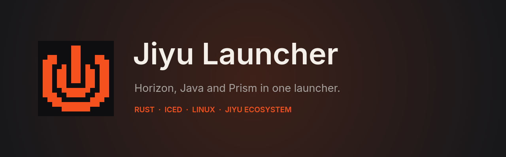

<p>


</p>

**Un launcher de Minecraft con la estructura de Prism Launcher, para jugar a la vez a Horizon (Minecraft reescrito en Rust) y a Minecraft Java de siempre.**

Unos 50 MB de memoria en reposo, 0 % de CPU, y se aparta mientras juegas.

[Instalar](#instalar) · [Cómo se usa](#cómo-se-usa) · [Temas](#temas) · [Ecosistema Jiyu](#el-ecosistema-jiyu) · [Preguntas](#preguntas-frecuentes)

</div>


## Qué tiene

- **Todas tus instancias en una ventana.** Las de Horizon (Rust), las de Java que crea Horizon y las de Prism Launcher, que se leen tal como están sin cambiar nada de Prism. Una insignia y un filo de color distinguen Rust de Java sin tener que leer.
- **Una interfaz más cuidada.** La estructura de Prism que ya conoces, redibujada: iconos vectoriales suaves, tarjetas redondeadas, un panel con tiempo jugado y última partida, menús de clic derecho de verdad y cuatro temas. Las listas están hechas para ir fluidas con cientos de instancias.
- **Tres vistas:** por grupos (con las líneas de Prism), carpetas como Nautilus, con carpetas dentro de carpetas, y lista. Carpetas de colores, orden a mano arrastrando, favoritas y un archivador para lo que no quieres ver, también grupos enteros.
- **Mods, shaders y texturas de Modrinth** con un clic. Cada descarga va a una cola que sigue bajando mientras buscas otra cosa. Lo que ya tiene la instancia sale como «Instalado» (se reconoce por la huella del archivo), y las dependencias se bajan solas. En las instancias Rust, Horizon porta el mod Java y te dice si funciona entero o en parte.
- **Modpacks:** crea una instancia directamente desde un modpack de Modrinth, o copia una instancia de Prism a Horizon.
- **Big Picture**: pantalla completa para jugar desde el sofá, con estantes («Seguir jugando» y uno por carpeta) que se recorren con las flechas. `F11` para entrar y salir.
- **Mods nativos de Horizon**: se instalan desde el launcher y se compilan con un botón por instancia.
- **Jiyu dentro del juego:** el logo de 16 px abajo a la izquierda en Horizon y como icono de la ventana del juego. Las dos cosas son opcionales.
- **Armario**: tus skins en 3D, que puedes girar, la skin y las capas de tu cuenta, y una skin distinta por instancia que se pone sola al jugar.
- **Servidores**: los añades una vez y aparecen en la lista Multijugador de todas tus instancias, con su estado en vivo (jugadores, ping y descripción).
- **Perfiles de rendimiento:** GameMode, MangoHud, gráfica dedicada, optimizaciones de NVIDIA, memoria y recolector de Java y páginas grandes, según el perfil de tu PC.
- **Temas**: Prism Dark, Prism Bright, Matugen y Jiyu Pulse. Con la mascota de la esquina (el gato de Prism o la de Jiyu), que se puede quitar.
- **Ligero**: se dibuja por software por defecto, así no compite con el juego por la gráfica. Al jugar se cierra y deja un vigilante de 4 MB que lo vuelve a abrir cuando terminas.
- **Instalación con un comando**, que pone los paquetes del sistema, Rust y Horizon (comprobado con SHA256).

**Próximamente**

- **Instancias de Minecraft Legacy Edition**, junto a las de Horizon, Java y Prism.
- Interfaz en inglés.
- Mando en Big Picture.
- Arrancar las instancias Java (vanilla, Fabric y Quilt) sin Horizon.

| Big Picture | Explorar mods |
|---|---|
| 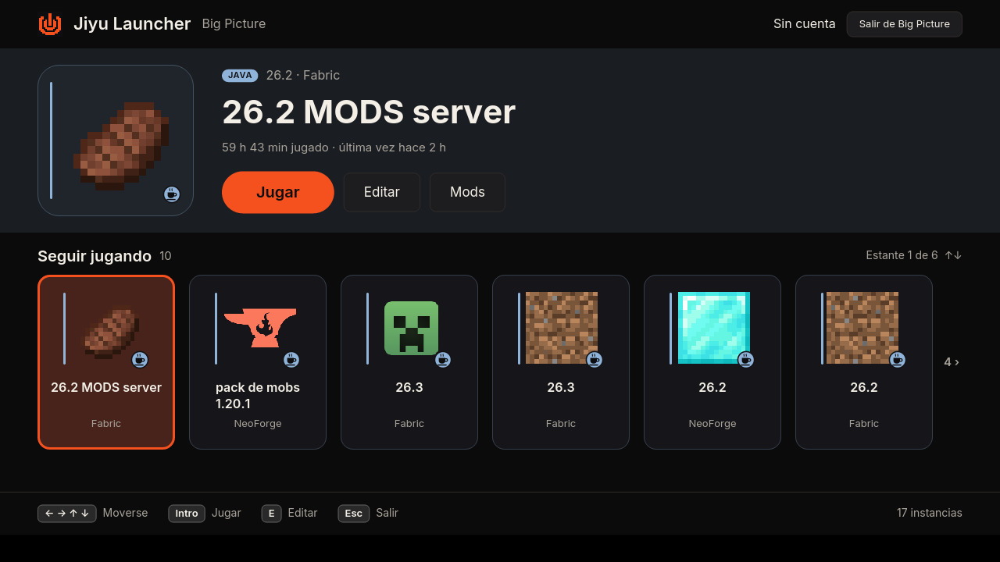 | 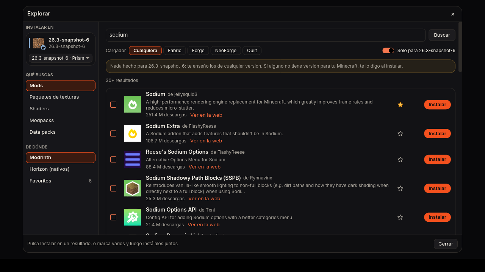 |
| **Mods nativos de Horizon** | **Servidores** |
| 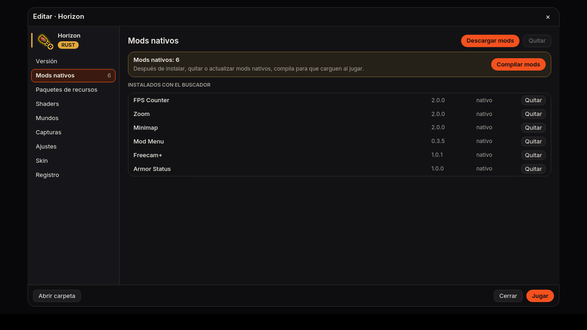 | 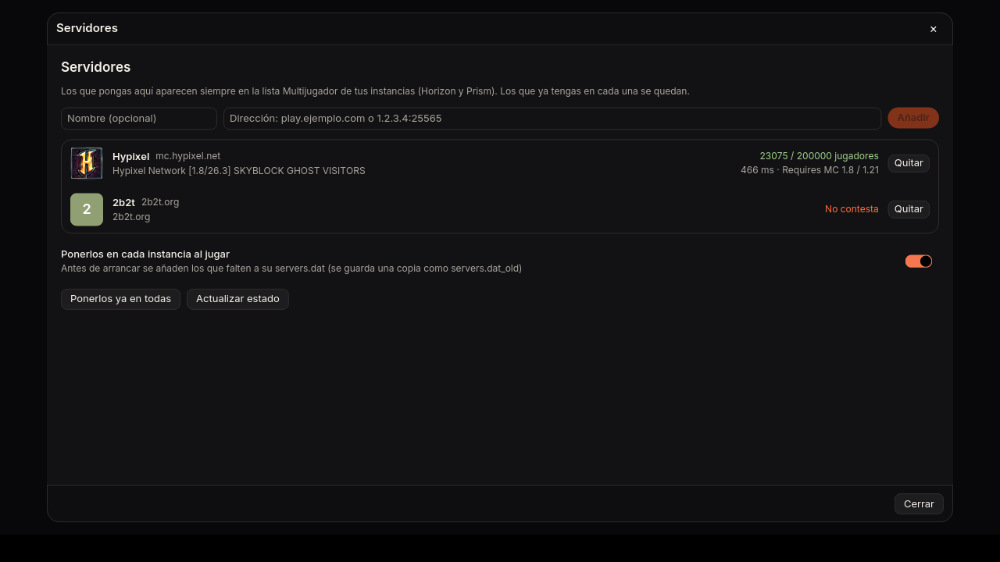 |
| **Carpetas** | **Ajustes** |
| 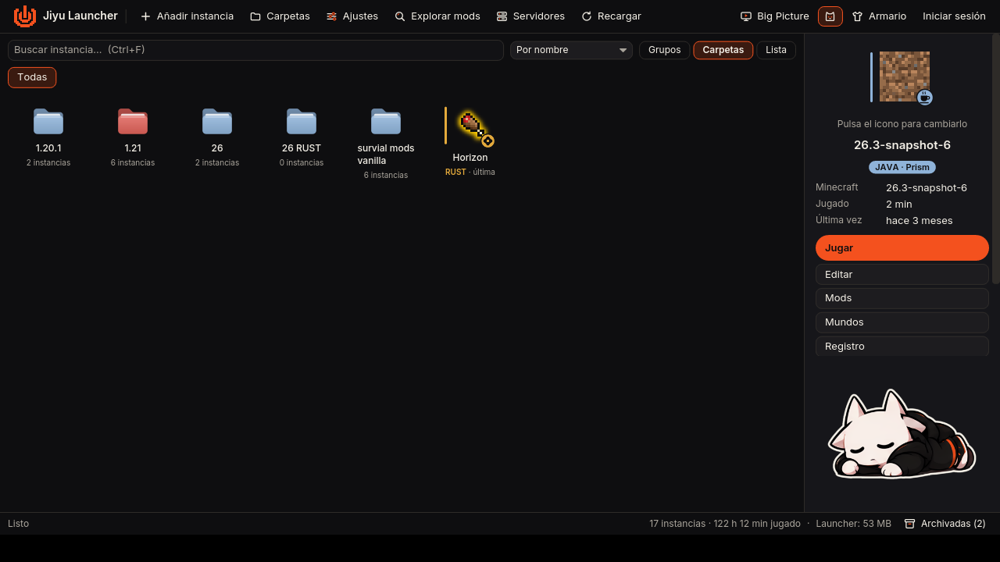 | 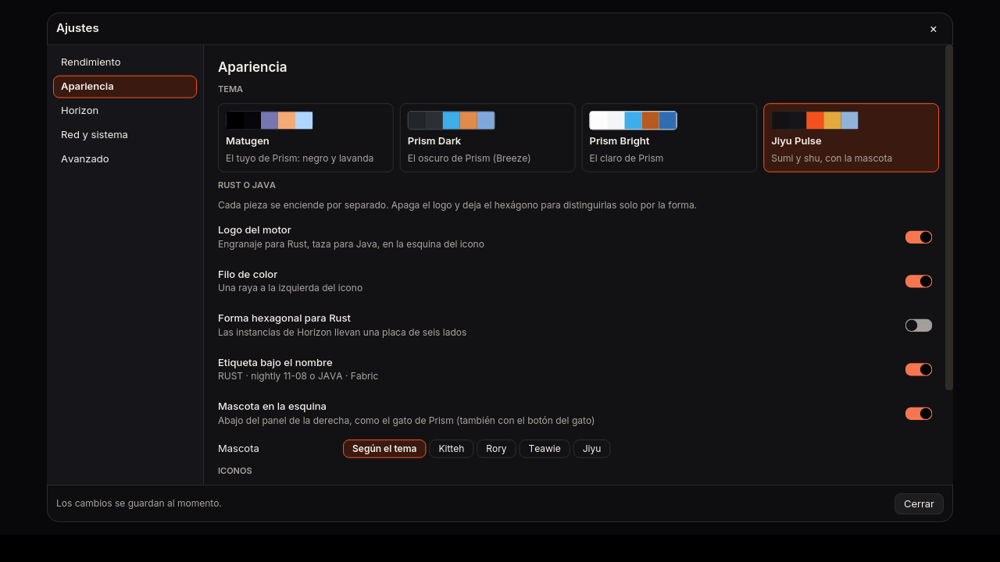 |

## Temas

Cuatro temas, que se cambian al momento en *Ajustes → Apariencia*. El principal es **Jiyu Pulse**: sumi (casi negro) con el bermellón shu de la marca Jiyu, la mascota de Jiyu en la esquina y botones redondeados.

| Jiyu Pulse | Matugen |
|---|---|
| 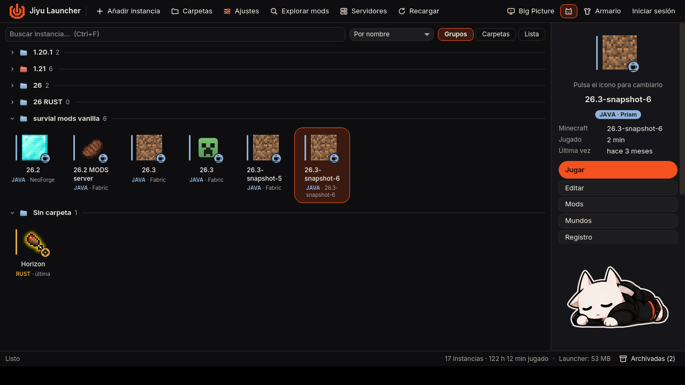 | 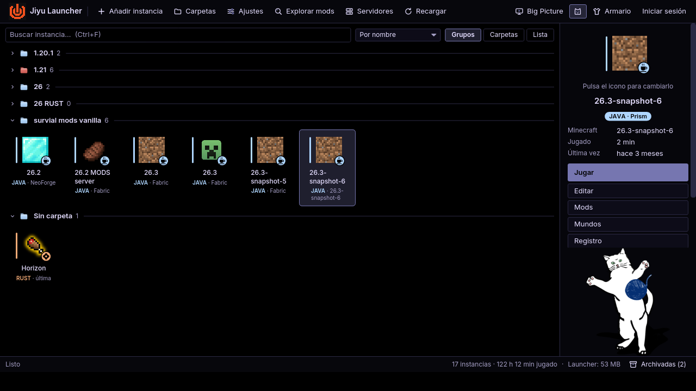 |
| **Prism Dark** | **Prism Bright** |
| 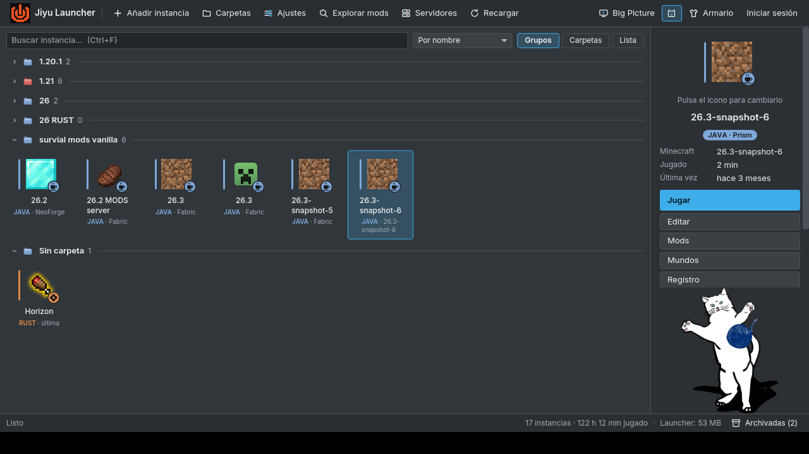 | 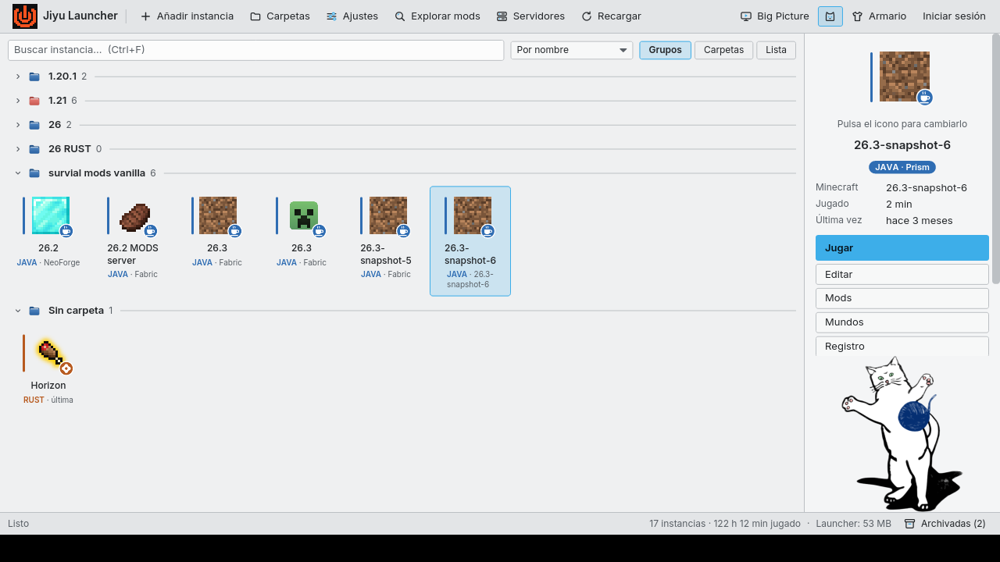 |

## El ecosistema Jiyu

Jiyu Launcher es una pieza de **Jiyu**, una familia de apps libres hechas por una persona, con la misma marca (el pulso, el bermellón shu sobre sumi y la mascota) y las mismas reglas: sin anuncios, sin cuentas propias y sin telemetría.

| | App | Qué es | Estado |
|---|---|---|---|
|  | **Jiyu Launcher** | Este launcher de Minecraft para Horizon, Java y Prism, en Rust | En desarrollo, Linux |
|  | **Jiyu Pulse** | App de música para iPhone y Android: gratis, sin anuncios ni cuenta, con descargas, letras, Jam entre móviles y reproductores con personalidad (casete, vinilo) | En desarrollo |

Jiyu Pulse lleva el pulso de la marca en trazo suave. Jiyu Launcher lo lleva dibujado en píxeles, 16×16, como un bloque más de Minecraft : es el mismo en el launcher y dentro del juego.

## Instalar

Solo Linux (probado en Arch/CachyOS, x86_64).

```sh
git clone https://github.com/ToxBox8/jiyu-launcher.git
cd jiyu-launcher
./instalar.sh
```

El instalador hace todo, y te pregunta antes de instalar nada del sistema:

1. **Paquetes del sistema** que falten: git, curl, un compilador de C y las bibliotecas de ventana (Wayland, X11, xkbcommon, Vulkan). Usa pacman, apt, dnf o zypper.
2. **Rust**, con rustup y solo para tu usuario, si no tienes `cargo`.
3. **Compila** el launcher y lo instala en `~/.local/bin/jiyu-launcher`, con su entrada en el menú de aplicaciones.
4. **Horizon**, si no lo tienes: baja la última versión oficial de [horizon-rust/horizon](https://github.com/horizon-rust/horizon), comprueba su SHA256 y la deja en `~/Applications/horizon-launcher-linux-x86_64/`.

Opciones:

| Comando | Qué hace |
|---|---|
| `./instalar.sh --si` | Igual, pero sin preguntar |
| `./instalar.sh --sin-horizon` | No baja Horizon (solo verás tus instancias de Prism) |
| `./instalar.sh --desinstalar` | Quita el launcher; tus ajustes, skins e instancias se quedan |

**Para actualizar**: `git pull` y otra vez `./instalar.sh`.

### Qué necesitas para jugar

- **Una cuenta de Microsoft con Minecraft: Java Edition.** Se inicia sesión desde *Cuentas*, a través de Horizon.
- **Horizon** para las instancias Rust y para arrancar las de Java (baja Minecraft, Java y los cargadores él solo). El instalador lo pone si falta.
- **Prism Launcher no hace falta.** Si lo tienes, sus instancias salen también y se juegan con Prism.

## Cómo se usa

### Instancias

- **Clic** elige, **doble clic** juega. El panel de la derecha enseña la elegida: pulsa su icono para cambiarlo.
- **Clic derecho** en una instancia: Jugar, Editar, Cambiar icono, Mods, Descargar mods, shaders y texturas, Skin al jugar, Mover a otra carpeta, Abrir carpeta, Archivar y Eliminar. En las de Horizon, también Duplicar y Acceso directo en el escritorio; en las de Prism, Copiar a Horizon.
- **Nueva instancia** (`Ctrl+N` o *Añadir instancia*): de Horizon (Rust), de Java (vanilla, Fabric, Quilt, Forge o NeoForge), copiada de Prism o desde un modpack de Modrinth. Ahí mismo eliges icono, carpeta, memoria y skin.
- **Eliminar** pide escribir `BORRAR`. Las de Prism van a la papelera, no se borran del todo.

### Carpetas y grupos

- Tres vistas, arriba a la derecha: **Grupos** (como Prism, con líneas), **Carpetas** (como Nautilus: entras y sales de ellas) y **Lista**.
- Las carpetas pueden ir unas dentro de otras («1.21 › mods»). Arrastra una instancia a una carpeta para moverla.
- Clic derecho en una carpeta: nueva instancia dentro, carpeta nueva dentro, **color** (9 colores), renombrar, **archivar el grupo** o quitar la carpeta (lo de dentro sube un nivel).
- **Orden**: por nombre, última vez, más jugadas o **a mano**. Para el orden a mano, arrastra una instancia encima de otra.
- **Archivador** (abajo a la derecha): lo archivado no sale en la ventana ni en las búsquedas, pero sigue ahí con sus mundos. Se puede jugar desde dentro y sacar cuando quieras, tanto instancias sueltas como grupos enteros.

### Descargar mods, shaders y texturas

Se abre con *Explorar mods*, con clic derecho → *Descargar…*, o desde *Editar → Mods / Paquetes de recursos / Shaders* de una instancia (así ya va apuntando a ella).

- A la izquierda eliges **dónde instalar**, **qué buscas** (mods, paquetes de texturas, shaders, modpacks o data packs) y **de dónde** (Modrinth, Horizon o tus favoritos).
- Cada resultado tiene su botón **Instalar**. También puedes **marcar varios** con la casilla (o con doble clic en la fila) e instalarlos juntos. Las marcas se conservan aunque cambies de búsqueda o de tipo.
- Todo va a una **cola de descargas** que sigue bajando aunque cambies de búsqueda, de tipo o de instancia. El botón cambia a *En cola*, *Bajando…* y *✓ Instalado*, o a *Reintentar* si falla. En el pie, *Descargas* enseña la cola con el error de cada una.
- Lo que la instancia **ya tiene** sale como *Instalado*: se reconoce la huella (SHA-1) de cada archivo en Modrinth.
- Las **dependencias obligatorias** se bajan solas, para la versión de Minecraft y el cargador de la instancia.
- **Filtros**: cargador y «Solo para tu versión». Si no hay nada hecho para tu versión (pasa con las snapshots), te enseña los de cualquier versión y te avisa.
- Al llegar al final de la lista se cargan más resultados solos.
- La **estrella** guarda un proyecto en favoritos.
- Si intentas meter un mod en una instancia sin Fabric ni Forge, o un data pack fuera de un mundo, te lo dice en vez de instalarlo mal.

Cómo instala según la instancia:

| Instancia | Cómo se instala |
|---|---|
| Prism | Directo de Modrinth a su carpeta `mods/`, `resourcepacks/` o `shaderpacks/` |
| Java de Horizon | Lo instala Horizon, que comprueba las sumas de cada archivo |
| Rust (Horizon) | Horizon **porta el mod Java** a Horizon. En la lista ves si funciona entero o en parte |
| Shaders en cualquiera | Directo de Modrinth. En las Rust, Horizon usa sus propios shaders: elige la fuente *Horizon (nativos)* |

### Mods nativos de Horizon (compilar)

Los **mods nativos** (`.hnmod`, de la fuente *Horizon (nativos)*) no cargan hasta que se compila el juego con ellos.

1. Instala los mods nativos que quieras.
2. Ve a **Editar → Mods nativos** de la instancia Rust y pulsa **Compilar mods**.
3. Confirma. Estos mods se ejecutan con acceso total a tu ordenador, como cualquier programa: compila solo si confías en sus autores. Los del registro de Horizon están revisados; los instalados desde GitHub, no.
4. La primera vez Horizon baja su propio Rust y tarda **20–30 minutos**; después, unos minutos. Ves el progreso en vivo, puedes cerrar la ventana y te avisa al terminar.

Vuelve a compilar cada vez que instales, quites o actualices un mod nativo. También llegas aquí desde *Explorar* («Ir a compilar») y desde Big Picture.

### Big Picture

Para jugar desde el sofá: `F11` o el botón *Big Picture* de la barra.

- Arriba sale la instancia elegida en grande, con **Jugar**, **Editar** y **Mods** (y **Compilar mods** en las Rust).
- Debajo van los **estantes**: *Seguir jugando* (las 10 últimas) y uno por carpeta. Te mueves con las flechas o con la rueda del ratón.
- `Intro` juega, `E` edita, `Esc` o `F11` sale. Las flechas solo mueven, nunca juegan. Con el ratón, un clic elige y otro clic sobre la elegida juega.
- Solo se dibuja lo que cabe en pantalla. «‹ 2» o «3 ›» avisan de que hay más tarjetas a ese lado, y «Estante 3 de 6» de que hay más estantes.

### Armario y skins

- Tus skins en **3D**: arrastra para girarlas. Puedes importar más desde un archivo.
- Cambia la **skin y la capa de tu cuenta** de Minecraft desde aquí.
- **Skin por instancia** (*Editar → Skin*): la que tienes puesta, una del armario o una importada. Se sube a tu cuenta justo antes de jugar esa instancia.
- La cabeza de tu skin sale junto a tu nombre, arriba a la derecha.

### Servidores

- Añade servidores (nombre y dirección) en *Servidores*. Aparecen **en la lista Multijugador de todas tus instancias**, de Horizon y de Prism.
- Se añaden antes de jugar, o en el momento con *Ponerlos ya en todas*. Los servidores que ya tenía cada instancia se quedan, y se guarda una copia `servers.dat_old`.
- Ves si cada servidor está en línea sin abrir el juego: jugadores, ping, descripción e icono.

### Ajustes

| Página | Qué tiene |
|---|---|
| Rendimiento | Perfiles según tu PC, cerrar el launcher al jugar, GameMode, MangoHud, gráfica dedicada, optimizaciones de NVIDIA, memoria y recolector de Java, páginas grandes, *Dibujar con la gráfica* y el servidor integrado de Horizon en su propio hilo |
| Apariencia | Tema, insignia Rust/Java, filo de color, hexágono para las Rust, etiqueta bajo el nombre, mascota de la esquina, tamaño de los iconos y mostrar o no las instancias de Prism |
| Horizon | Mods nativos (perfil de compilación y límite de su caché), Jiyu dentro del juego (logo e icono de la ventana), versiones (instalar las nuevas solas, borrar las viejas y cuántas guardar) y argumentos del juego |
| Red y sistema | Proxy (http o socks5, vale para Horizon y para las descargas del launcher), volver a abrir el launcher al cerrar el juego, espacio de las cachés y lista de atajos |
| Avanzado | Dónde están Horizon, Prism y tus ajustes |

*Dibujar con la gráfica* (en Rendimiento) hace la ventana más fluida (sobre todo Big Picture a pantalla completa), pero gasta unos 150 MB en vez de 50. Se aplica al volver a abrir el launcher.

### Jiyu dentro del juego (Horizon)

En *Ajustes → Horizon → Jiyu dentro del juego*:

- **Logo de Jiyu en el juego**: el pulso de 16 px abajo a la izquierda, en partida, en los menús y en la pantalla de título. `F1` lo esconde, como el resto de la interfaz, y se puede apagar en el propio juego (*Opciones → Mods → Jiyu Logo*). Es un mod nativo pequeño (`horizon-mod/`, va dentro del launcher): se añade al pulsar **Compilar mods** en *Editar → Mods nativos*, junto a tus otros mods nativos. Solo en las instancias Rust.
- **Icono de Jiyu en la ventana del juego**: el logo de 16 px como icono del juego de Horizon en la barra de tareas y el selector de ventanas. Cambia el `Icon=` de `~/.local/share/applications/horizon.desktop` y lo vuelve a poner antes de cada partida, por si Horizon rehace ese archivo. Al apagarlo vuelve el icono de Horizon.

Las instancias Java no pueden llevar el logo dentro: haría falta un mod de Fabric o Forge para cada versión.

## Teclas

| Tecla | Ventana normal | Big Picture |
|---|---|---|
| `Intro` | Jugar la instancia elegida | Jugar |
| `← → ↑ ↓` | | Moverse por los estantes |
| `E` | | Editar |
| Rueda del ratón | | Cambiar de estante o de tarjeta |
| `Esc` | Cerrar el diálogo o el menú | Salir de Big Picture |
| `F11` | Entrar en Big Picture | Salir |
| `Ctrl+F` | Buscar instancia | |
| `Ctrl+N` | Nueva instancia | |
| `Supr` | Eliminar (pide escribir BORRAR) | |
| `F5` | Recargar | |

## Preguntas frecuentes

**¿Hace falta tener Horizon?**
Sí, para jugar: arranca las instancias Rust y las de Java (baja Minecraft, Java y los cargadores él solo) y hace el inicio de sesión de Microsoft. El instalador lo pone si falta. Sin Horizon solo verás tus instancias de Prism.

**¿Y Prism Launcher?**
No hace falta. Si lo tienes, sus instancias salen en la ventana y se juegan con Prism. Solo se escribe en ellas al instalar mods o al borrarlas.

**¿Funciona Essential en las instancias Rust?**
No. Horizon lo analiza (`horizon-launcher mods check essential`) y responde *Doesn't run*. El archivo de Essential en Modrinth es un cargador de dos clases que, al arrancar Java, baja el mod de verdad (cerrado) de los servidores de Essential. Horizon solo puede portar lo que viene dentro del archivo, y ahí no hay nada. Para jugar con amigos en Horizon, usa sus propias funciones (abrir el mundo a amigos, emotes) o una instancia Java con Essential.

**¿Por qué no descarga un mod?**
Abre *Descargas* en el pie de Explorar: cada fallo dice por qué. Lo normal es que no haya versión para tu Minecraft o tu cargador, o que la instancia no tenga cargador de mods.

**¿Se puede depender menos de Horizon?**
Las descargas ya no dependen de él (salvo en sus propias instancias, donde va bien y además porta los mods a Rust). El siguiente paso sería arrancar las instancias Java por cuenta propia (vanilla, Fabric y Quilt primero), bajando Java de Adoptium o de Mojang. El inicio de sesión necesitaría una app propia en Azure aprobada por Mojang. Las instancias Rust siempre necesitarán Horizon, porque Horizon es el propio juego.

## Problemas conocidos

- **Logo dentro del juego**: el mod se ha escrito contra la API de mods nativos de tu Horizon (nightly 11-08, API 410) y sus pruebas pasan, pero aún no se ha compilado dentro del juego. Si la compilación falla, el error sale en *Editar → Mods nativos*.
- **Mando**: Big Picture se maneja con teclado y ratón; el mando todavía no.
- **Tipografía**: no hay letras chinas, japonesas ni coreanas incluidas; esos nombres de mods salen con cuadros.
- **Dibujo por software**: resaltar al pasar el ratón en los menús solo funciona con *Dibujar con la gráfica*. Sin ella dejaba restos al repintar.
- **De RustCraft a Jiyu**: si jugaste con la versión de antes del cambio de nombre, puede quedar algún vigilante viejo (`rustcraft --vigilar`) esperando a que cierres el juego. Ciérralo con `pkill -f 'release/rustcraft --vigilar'`.

## Pendiente

- Instancias de Minecraft Legacy Edition.
- Interfaz en inglés.
- Arranque propio de las instancias Java (vanilla, Fabric y Quilt) sin pasar por Horizon.
- Mando en Big Picture.
- App propia de Azure para el inicio de sesión, cuando Mojang la apruebe.
- La capa propia del launcher.

## Dónde guarda las cosas

| Qué | Dónde |
|---|---|
| Ajustes | `~/.config/jiyu-launcher/ajustes.json` |
| Skins y registros de partidas | `~/.local/share/jiyu-launcher/` |
| Logos de mods, iconos y gatos de Prism | `~/.cache/jiyu-launcher/` (se puede borrar) |
| Instancias de Horizon | Las de Horizon, en `~/.local/share/horizon/` |
| Instancias de Prism | Donde las tenga Prism; solo se escribe en ellas al instalar mods o al borrar |

Si vienes de cuando se llamaba RustCraft, las carpetas `rustcraft` se renombran solas la primera vez que lo abres.

## Privacidad

Sin telemetría. Solo se conecta a Modrinth (búsquedas, descargas y logos), a GitHub (los iconos de serie de Prism), a la API de Minecraft (tu skin y tus capas) y a los servidores que añadas, para ver su estado. El token de tu cuenta se pide a Horizon para un solo uso, se borra al momento y se pasa a `curl` por la entrada estándar: no se guarda en ningún sitio ni aparece en la lista de procesos.

## Desarrollo

```sh
cargo build --release
./target/release/jiyu-launcher
```

La estructura del código, las medidas de rendimiento y cómo hacer capturas sin ratón están en [docs/DESARROLLO.md](docs/DESARROLLO.md). Para colaborar, mira [CONTRIBUTING.md](CONTRIBUTING.md); los cambios de cada versión están en [CHANGELOG.md](CHANGELOG.md).

El mod nativo del logo está en [`horizon-mod/`](horizon-mod/): sus pruebas se pasan con `rustc --test horizon-mod/mixins/jiyu_logo/runtime.rs`.

## Licencia

El código es MIT (ver [LICENSE](LICENSE)). La tipografía Inter va con su licencia OFL (`assets/fonts/Inter-LICENSE.txt`). El logo y la mascota de Jiyu son de la marca Jiyu y no entran en la licencia MIT.

Jiyu Launcher no es un producto oficial de Minecraft ni está aprobado por Mojang o Microsoft. Horizon y Prism Launcher son proyectos aparte.
