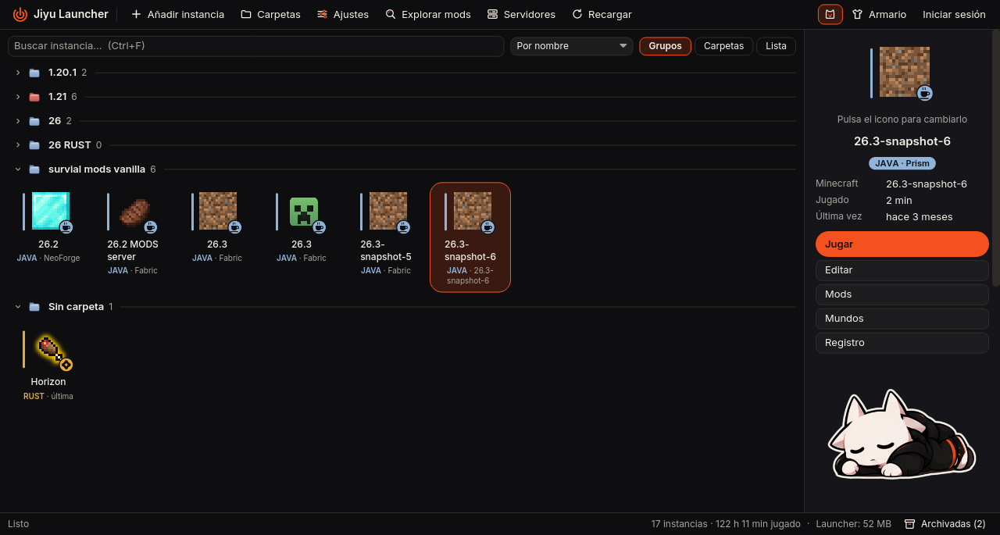
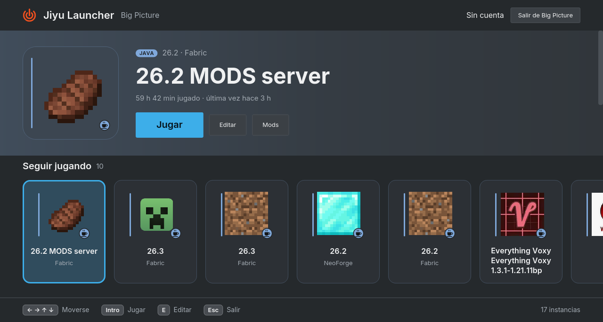
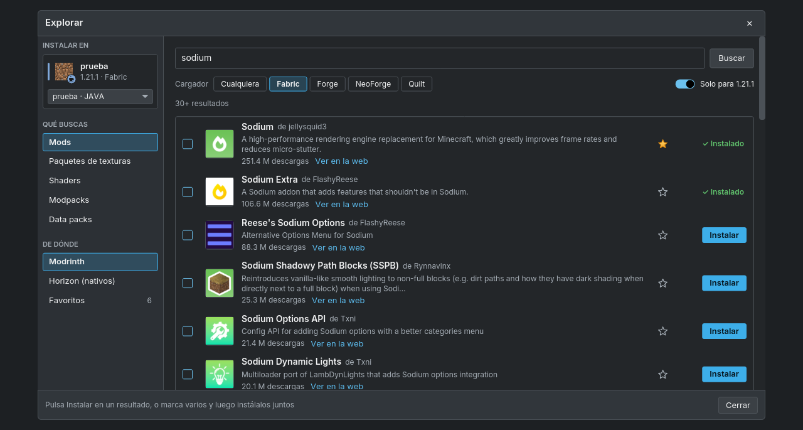
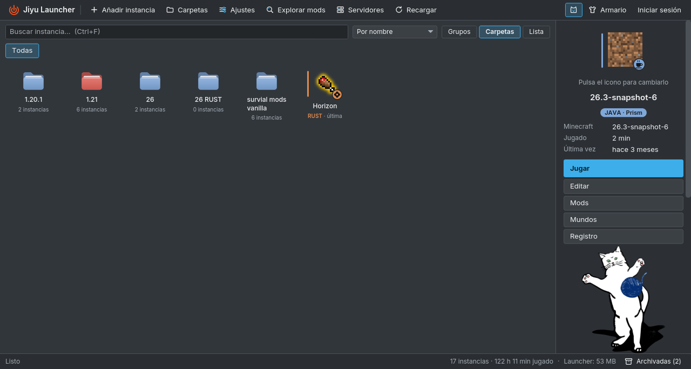
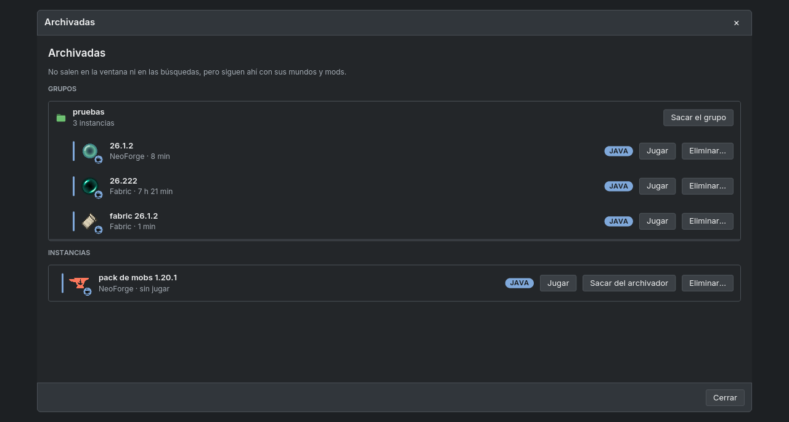

<div align="center">


# Jiyu Launcher

**Un launcher de Minecraft con la estructura de Prism Launcher, para jugar a la vez a Horizon (Minecraft reescrito en Rust) y a Minecraft Java de siempre.**

Escrito en Rust con [iced](https://iced.rs). Unos 50 MB de memoria en reposo, 0 % de CPU, y se aparta mientras juegas.

</div>



## Qué tiene

- **Todas tus instancias en una ventana.** Las de Horizon (Rust), las de Java que crea Horizon y las de Prism Launcher, que se leen tal como están sin cambiar nada de Prism. Una insignia y un filo de color distinguen Rust de Java sin tener que leer.
- **Tres vistas:** por grupos (con las líneas de Prism), carpetas como Nautilus, con carpetas dentro de carpetas, y lista. Carpetas de colores, orden a mano arrastrando, favoritas y un archivador para lo que no quieres ver, también grupos enteros.
- **Mods, shaders y texturas de Modrinth** con un clic. Cada descarga va a una cola que sigue bajando mientras buscas otra cosa. Lo que ya tiene la instancia sale como «Instalado» (se reconoce por la huella del archivo), y las dependencias se bajan solas. En las instancias Rust, Horizon porta el mod Java y te dice si funciona entero o en parte.
- **Big Picture**: pantalla completa para jugar desde el sofá, con estantes («Seguir jugando» y uno por carpeta) que se recorren con las flechas. `F11` para entrar y salir.
- **Armario**: tus skins en 3D, que puedes girar, la skin y las capas de tu cuenta, y una skin distinta por instancia que se pone sola al jugar.
- **Servidores**: los añades una vez y aparecen en la lista Multijugador de todas tus instancias, con su estado en vivo (jugadores, ping y descripción).
- **Temas**: Prism Dark, Prism Bright, Matugen y Jiyu Pulse. Con la mascota de la esquina (el gato de Prism o la de Jiyu), que se puede quitar.
- **Ligero**: se dibuja por software por defecto, así no compite con el juego por la gráfica. Al jugar se cierra y deja un vigilante de 4 MB que lo vuelve a abrir cuando terminas.

| Big Picture | Explorar mods |
|---|---|
|  |  |
| **Carpetas** | **Archivador** |
|  |  |

## Instalar

Solo Linux (probado en Arch/CachyOS, x86_64).

```sh
git clone https://github.com/ToxBox8/jiyu-launcher.git
cd jiyu-launcher
./instalar.sh
```

El instalador hace todo, y te pregunta antes de instalar nada del sistema:

1. **Paquetes del sistema** que falten: git, curl, un compilador de C y las bibliotecas de ventana (Wayland, X11, xkbcommon, Vulkan). Usa pacman, apt, dnf o zypper.
2. **Rust**, con rustup y solo para tu usuario, si no tienes `cargo`.
3. **Compila** el launcher y lo instala en `~/.local/bin/jiyu-launcher`, con su entrada en el menú de aplicaciones.
4. **Horizon**, si no lo tienes: baja la última versión oficial de [horizon-rust/horizon](https://github.com/horizon-rust/horizon), comprueba su SHA256 y la deja en `~/Applications/horizon-launcher-linux-x86_64/`.

Opciones:

| Comando | Qué hace |
|---|---|
| `./instalar.sh --si` | Igual, pero sin preguntar |
| `./instalar.sh --sin-horizon` | No baja Horizon (solo verás tus instancias de Prism) |
| `./instalar.sh --desinstalar` | Quita el launcher; tus ajustes, skins e instancias se quedan |

**Para actualizar**: `git pull` y otra vez `./instalar.sh`.

### Qué necesitas para jugar

- **Una cuenta de Microsoft con Minecraft: Java Edition.** Se inicia sesión desde *Cuentas*, a través de Horizon.
- **Horizon** para las instancias Rust y para arrancar las de Java (baja Minecraft, Java y los cargadores él solo). El instalador lo pone si falta.
- **Prism Launcher no hace falta.** Si lo tienes, sus instancias salen también y se juegan con Prism.

## Teclas

| Tecla | Ventana normal | Big Picture |
|---|---|---|
| `Intro` | Jugar la instancia elegida | Jugar |
| `← → ↑ ↓` | | Moverse por los estantes |
| `E` | | Editar |
| `Esc` | Cerrar el diálogo o el menú | Salir de Big Picture |
| `F11` | Entrar en Big Picture | Salir |
| `Ctrl+F` | Buscar instancia | |
| `Ctrl+N` | Nueva instancia | |
| `Supr` | Eliminar (pide escribir BORRAR) | |
| `F5` | Recargar | |

## Dónde guarda las cosas

| Qué | Dónde |
|---|---|
| Ajustes | `~/.config/jiyu-launcher/ajustes.json` |
| Skins y registros de partidas | `~/.local/share/jiyu-launcher/` |
| Logos de mods, iconos y gatos de Prism | `~/.cache/jiyu-launcher/` (se puede borrar) |
| Instancias de Horizon | Las de Horizon, en `~/.local/share/horizon/` |
| Instancias de Prism | Donde las tenga Prism; solo se escribe en ellas al instalar mods o al borrar |

Si vienes de cuando se llamaba RustCraft, las carpetas `rustcraft` se renombran solas la primera vez que lo abres.

## Privacidad

Sin telemetría. Solo se conecta a Modrinth (búsquedas, descargas y logos), a GitHub (los iconos de serie de Prism), a la API de Minecraft (tu skin y tus capas) y a los servidores que añadas, para ver su estado. El token de tu cuenta se pide a Horizon para un solo uso, se borra al momento y se pasa a `curl` por la entrada estándar: no se guarda en ningún sitio ni aparece en la lista de procesos.

## Desarrollo

```sh
cargo build --release
./target/release/jiyu-launcher
```

La estructura del código, las medidas de rendimiento y cómo hacer capturas sin ratón están en [docs/DESARROLLO.md](docs/DESARROLLO.md).

## Licencia

El código es MIT (ver [LICENSE](LICENSE)). La tipografía Inter va con su licencia OFL (`assets/fonts/Inter-LICENSE.txt`). El logo y la mascota de Jiyu son de la marca Jiyu y no entran en la licencia MIT.

Jiyu Launcher no es un producto oficial de Minecraft ni está aprobado por Mojang o Microsoft. Horizon y Prism Launcher son proyectos aparte.
